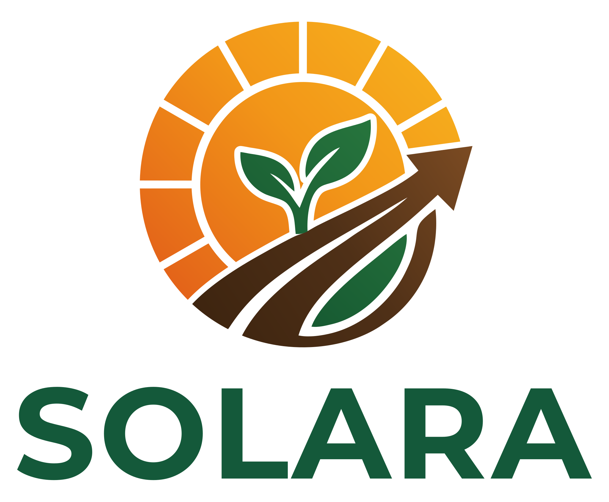

# Solara Fertilizantes — Guia da marca

Tudo o que é preciso para criar uma peça nova da Solara (post, carrossel, story, vídeo, imagem ou texto)
sem ter que perguntar de novo. Onde ainda falta informação está marcado como **A PREENCHER**.

> Atualizado em 06/11/2026, a partir do guia de referência da Solara no projeto do Claude e do site
> oficial (solarafertilizantes.com).
> Este repositório é público: aqui ficam só informações de marca. Preços, pedidos, clientes e
> certificados ficam fora daqui.

## Sumário

1. [O que é a Solara](#1-o-que-é-a-solara)
2. [Público](#2-público)
3. [Tom de voz](#3-tom-de-voz)
4. [Identidade visual](#4-identidade-visual)
5. [Produtos](#5-produtos)
6. [Criativos já feitos](#6-criativos-já-feitos)
7. [Regras: o que nunca publicar](#7-regras-o-que-nunca-publicar)
8. [Contexto pronto para o gerador de criativos](#8-contexto-pronto-para-o-gerador-de-criativos)
9. [Pendências](#9-pendências)

---

## 1. O que é a Solara

A Solara é uma empresa de comércio de fertilizantes e transporte, com sede em Curitiba/PR, desde 2025.
Trabalha com comércio atacadista de adubos, fertilizantes, corretivos do solo e defensivos agrícolas,
e vende fertilizantes para lavoura e ureia para nutrição animal.

| Item | Informação |
| --- | --- |
| Razão social | Solara Comércio de Fertilizantes e Transportes Ltda |
| CNPJ | 64.979.522/0001-60 |
| Endereço | R. Buenos Aires, 71, Batel, Curitiba/PR, CEP 80.250-070 |
| WhatsApp (contato e cotação) | (41) 99810-3880 · https://wa.me/5541998103880 |
| E-mail | solarafertilizantes@gmail.com |
| Site | https://solarafertilizantes.com |
| Instagram | [@solarafertilizantes](https://www.instagram.com/solarafertilizantes/) |
| Região de atendimento | PR, SP, MS e MT (o site também diz "produtores rurais em todo o Brasil") |
| Fundação | 2025, em Curitiba/PR ("Uma empresa do Paraná, com o Brasil inteiro pela frente.") |
| Diferenciais (como estão no site) | Insumos selecionados · Foco em produtividade · Nutrição completa · Atendimento próximo e direto |

## 2. Público

- Agricultores e produtores rurais.
- Pecuaristas (ureia pecuária para ração e sal mineral).
- Gestores agrícolas e de fazendas.
- Revendas de insumos.
- Região: PR, SP, MS e MT.
- Culturas e porte principais: **A PREENCHER** (ex.: soja e milho, médio porte).

**Objetivo da comunicação:** dar visibilidade à marca, gerar contatos para cotação e posicionar a
Solara como referência em fertilizantes.

## 3. Tom de voz

Profissional, educativo e com autoridade. A Solara ensina o produtor e mostra que entende do assunto.

| Faça | Evite |
| --- | --- |
| Textos curtos e diretos | Exagero e superlativos ("o melhor do Brasil") |
| Explicar para que serve cada produto e quando usar | Números de resultado sem fonte |
| Dados técnicos reais (ex.: "46% de N") | Prometer serviço que não existe |
| Fechar sempre com a chamada de cotação | Gírias e excesso de emojis |

- **Referência de estilo:** Fertybio, pelo conteúdo educativo, visual profissional e foco em dados e benefícios.
- **Chamada padrão (CTA):** "Peça sua cotação" + WhatsApp (41) 99810-3880 + @solarafertilizantes.
- **Frases já aprovadas:**
  - "Fertilizante de qualidade, do galpão até a sua lavoura"
  - "Do porto até a sua lavoura"
- **Slogan (frase principal do site):** "Onde o sol encontra a terra, nasce a colheita."
- **Outras frases do site:** "Do solo à colheita, ao seu lado." · "Tudo o que sua lavoura precisa, de uma só origem." ·
  "Cuidar do solo é cuidar do futuro." · "Vamos preparar a próxima safra juntos?"

## 4. Identidade visual

### Logo



- Desenho: sol laranja com raios dourados, um broto verde no centro e uma seta marrom (o caminho da
  terra) subindo para a direita. Abaixo, "SOLARA" em verde escuro e a razão social em letras menores.
  Nos vídeos, os raios giram e a seta serve de transição.
- Arquivos neste repositório:
  - [`solara-logo.svg`](logo/solara-logo.svg): **logo oficial em vetor**, fundo transparente, símbolo +
    "SOLARA" (sem a linha da razão social). Use esta sempre que possível; aumenta sem perder qualidade.
  - [`solara-logo.png`](logo/solara-logo.png): a mesma logo em PNG transparente, 1400 × 1156, para
    Canva e redes sociais.
  - [`solara-logo.jpg`](logo/solara-logo.jpg): versão antiga, com a razão social e fundo branco.
- Os espaços brancos entre os raios são transparentes: em fundo escuro, eles mostram a cor do fundo.
  Prefira aplicar a logo sobre branco, off-white ou verde.
- Símbolo isolado (sem o nome): **A PREENCHER** (dá para recortar do SVG, grupo `simbolo`).

### Cores

| Cor | Uso | Hex |
| --- | --- | --- |
| Verde | Principal: fundos e títulos (nome SOLARA) | `#14593A` · `#1F5E3B` (variação usada no site) |
| Laranja | Destaque: sol, bordas, faixas de transição | `#E25E19` (base do sol) · `#F29618` (meio) |
| Amarelo dourado | Topo do sol, detalhes e ícones | `#F7B21E` |
| Marrom | Apoio, ligado à terra (a seta/solo da logo) | `#4F3017` · degradê `#3A220E` → `#7A4A22` |
| Verde folha | Folhas e detalhes de natureza | `#2A7A3F` → `#11502E` |

Degradês da logo: sol `#F7B21E` → `#F29618` → `#E25E19`; solo `#3A220E` → `#4F3017` → `#7A4A22`;
folha `#2A7A3F` → `#11502E`.
| Neutro (fundo claro) | Posts alternados com o verde | Sugestão: off-white `#F7F3EA` |
| Cor dos 3 posts fixados | Terceira cor do feed (o laranja ficou forte demais) | Sugestão: areia/bege terroso `#D9C3A0`, mais calma que o laranja e ligada à terra |

### Tipografia

- Usadas no carrossel editorial da ureia: **DM Serif Display** (títulos) e **Inter** (texto).
- Padrão adotado para os criativos: **DM Serif Display** nos títulos e **Inter** nos textos (gratuitas,
  no Google Fonts e no Canva).

### Feed do Instagram

- Fundos alternados: um post verde, um neutro, outro verde.
- 3 posts fixados no topo com uma terceira cor (ainda não escolhida).
- Stories: 1080 × 1920, fundo verde, cabeçalho "SOLARA FERTILIZANTES".

### Padrão das imagens

- Fotografia documental realista, luz natural, cenário agrícola brasileiro.
- Cara de câmera DSLR ou celular bom, com textura, poeira e pequenas imperfeições.
- Nada com cara de render 3D.
- **Sem textos, logos, marcas ou marcas-d'água dentro da imagem.** Texto e logo entram depois, no
  Canva ou na edição.
- Imagens separadas (não montagem). Para o site: horizontal 4:3.

### Formatos

| Peça | Tamanho |
| --- | --- |
| Post / carrossel do feed | 1080 × 1350 (4:5), que ocupa mais tela no celular que o quadrado |
| Story e Reels | 1080 × 1920 (9:16) |
| Imagens do site | Horizontal 4:3 |

## 5. Produtos

| Produto | Composição | Uso | Como aparece nas imagens | Cuidados |
| --- | --- | --- | --- | --- |
| Ureia perolada (prill) | 46% N | Lavoura | **A PREENCHER** | Também vendida em Big Bag |
| Ureia agrícola | 46% N | Lavoura | Trator com distribuidor de dois discos aplicando em lavoura brasileira | Falta foto realista no site |
| Ureia pecuária | N, grau ração | Ração animal | **A PREENCHER** | Sempre misturada na ração ou no sal mineral, com orientação de veterinário ou zootecnista. **Nunca** mostrar dada direto ao gado ou pura no cocho |
| Cloreto de potássio (KCl) | 60% K₂O | Lavoura | Saco branco trançado; grãos de 2 a 4 mm entre avermelhado, rosado e marrom-claro | — |
| MAP 11-52-00 | 11% N · 52% P₂O₅ | Lavoura | **A PREENCHER** | — |
| Sulfato de amônio | 21% N · 24% S | Lavoura | Cristais brancos ou off-white, parecidos com açúcar cristal grosso; saco branco trançado | Menor perda de nitrogênio por volatilização (como diz o site) |
| Fertilizantes NPK | Sob consulta | Lavoura | **A PREENCHER** | No site aparecem como "sob consulta". Não citar fórmulas específicas até haver uma lista |

Embalagens: a ureia perolada também sai em Big Bag. Demais embalagens por produto (saco 50 kg, Big Bag,
granel): **A PREENCHER**. Até lá, não prometer embalagem específica nos criativos.

## 6. Criativos já feitos

Use como referência de estilo antes de criar algo novo.

### Instagram

- **Carrossel "Qual ureia escolher?"**: versão de 4 slides e versão editorial de 5 slides no Canva
  (DM Serif Display + Inter). Antes de postar: aplicar cores e logo oficiais e revisar o slide da
  ureia pecuária.
- **Stories "Direto do navio"** (4 telas): descarga no porto, terminando com a lista de produtos e o
  botão de cotação.
- **Stories do KCl** (5 telas): chegada, descarga, operação, qualidade e venda.
- **Plano de 12 posts:**

| # | Formato | Tema | Situação |
| --- | --- | --- | --- |
| 1 | Carrossel | Ureia: qual tipo escolher? | Feito |
| 2 | Post | Por que o KCl é essencial para a lavoura | A fazer |
| 3 | Post | MAP 11-52-00 | A fazer |
| 4 | Carrossel | Sulfato de amônio em números | A fazer |
| 5 | Post | NPK: a fórmula para cada fase | A fazer |
| 6 | Post | Custo-benefício: qual fertilizante rende mais | A fazer |
| 7 | Carrossel | Manejo integrado de fertilizantes | A fazer |
| 8 | Post | Sustentabilidade na agricultura | A fazer |
| 9 | Post | Dose por hectare | A fazer |
| 10 | Carrossel | Casos de clientes Solara | A fazer (precisa de clientes que autorizem) |
| 11 | Post | Calendário agrícola por safra | A fazer |
| 12 | Post | Fale com um especialista | A fazer |

> A copy já escrita para esses 12 posts tem números de exemplo inventados. Veja a seção 7 antes de usar.

### Vídeos (todos 1080 × 1920, para Reels e Stories)

| Data | Vídeo | Duração |
| --- | --- | --- |
| 29/10/2026 | "Do porto até a lavoura": navio, armazém, ureia na mão, produtos e encerramento com logo e contatos | 32 s |
| 25/10/2026 | Edição em 3 partes: Estrutura, Qualidade e Logística, com moldura e logo | 36 s |
| 16/10/2026 | Story "Fertilizante de qualidade, do galpão até a sua lavoura" | 30 s |
| 13/10/2026 | Filme de marca do KCl com raios do sol animados | 12 s |

Arquivos dos vídeos neste repositório: **A PREENCHER** (salvar em `solara/videos/` ou guardar o link).

**Para os próximos vídeos:** gravar no celular em 1080p ou 4K e enviar o arquivo original; ouvir o
áudio antes de postar; usar só trilhas sem direitos autorais.

### Prompt base de imagem

Ponto de partida para gerar fotos no ChatGPT, Gemini ou Midjourney:

```
Fotografia documental realista, luz natural, cenário agrícola brasileiro, [CENA].
Aparência de foto de câmera DSLR, com textura, poeira e pequenas imperfeições.
Sem textos, sem logos, sem marcas, sem marca-d'água. Não parecer render 3D.
Formato [4:3 horizontal | 4:5 vertical | 9:16 vertical].
```

## 7. Regras: o que nunca publicar

- **Números de resultado sem fonte.** A copy dos 12 posts tem exemplos inventados ("95% de absorção",
  "+32% de produtividade", "reduz custos em 23%"). Não publique nenhum deles.
- **Serviços não confirmados:** consultoria gratuita, análise de solo gratuita, laudos ou
  certificações, "logística própria" (o site não afirma frota própria; use "Do porto até a sua
  lavoura" sem dizer quem transporta).
- **Ureia pecuária** sendo dada direto ao gado ou despejada pura no cocho.
- Texto ou logo gerados pela IA dentro da foto.

## 8. Contexto pronto para o gerador de criativos

Cole o texto abaixo no campo **Contexto** do site (https://nossoemporio01-maker.github.io/claude/) ou
use com `--contexto` na linha de comando:

```
Marca: Solara Fertilizantes (Curitiba/PR, desde 2025), comércio de fertilizantes e transporte. Atende PR, SP, MS e MT.
Slogan: "Onde o sol encontra a terra, nasce a colheita."
Produtos: ureia perolada 46% N, ureia agrícola, ureia pecuária (sempre misturada na ração ou sal mineral, nunca dada pura ao gado), cloreto de potássio KCl 60% K2O (grão avermelhado/rosado), MAP 11-52-00, sulfato de amônio 21% N 24% S, NPK sob consulta.
Público: produtores rurais, pecuaristas, gestores agrícolas e revendas.
Tom: profissional, educativo, de autoridade; textos curtos e diretos, sem exagero.
Cores: verde #14593A (principal), laranja #E25E19 e amarelo dourado #F7B21E (destaque, degradê do sol), marrom #4F3017 (apoio), fundo claro #F7F3EA. Fontes: DM Serif Display (títulos) e Inter (texto). Logo: sol laranja com raios dourados, broto verde e seta marrom.
Imagens: fotografia documental realista, luz natural, cenário agrícola brasileiro, sem texto nem logo dentro da imagem, nada de render 3D.
CTA: "Peça sua cotação" — WhatsApp (41) 99810-3880 — @solarafertilizantes.
Frases aprovadas: "Fertilizante de qualidade, do galpão até a sua lavoura"; "Do porto até a sua lavoura".
Proibido: números de produtividade/economia sem fonte, prometer consultoria ou análise de solo grátis, laudos, "logística própria".
```

## 9. Pendências

Cores oficiais tiradas do arquivo vetorial da logo (SVG).
Resolvido em 06/11/2026 com o site oficial: CNPJ, região, fundação, diferenciais, slogan, verde
`#1F5E3B`, sulfato de amônio (21% N · 24% S), NPK "sob consulta" e "logística própria" (não afirmar).
Fontes, formato do feed e cores do neutro e dos fixados foram definidos como padrão sugerido.

Falta o Andre:

- [ ] Aprovar ou trocar as sugestões: neutro `#F7F3EA` e fixados `#D9C3A0`
- [ ] Fórmulas de NPK vendidas
- [ ] Embalagens por produto (saco 50 kg, Big Bag, granel)
- [ ] Culturas e porte dos clientes principais
- [ ] Enviar os vídeos para salvar em `solara/videos/` (ou guardar os links)
- [ ] Foto realista da ureia agrícola para o site
